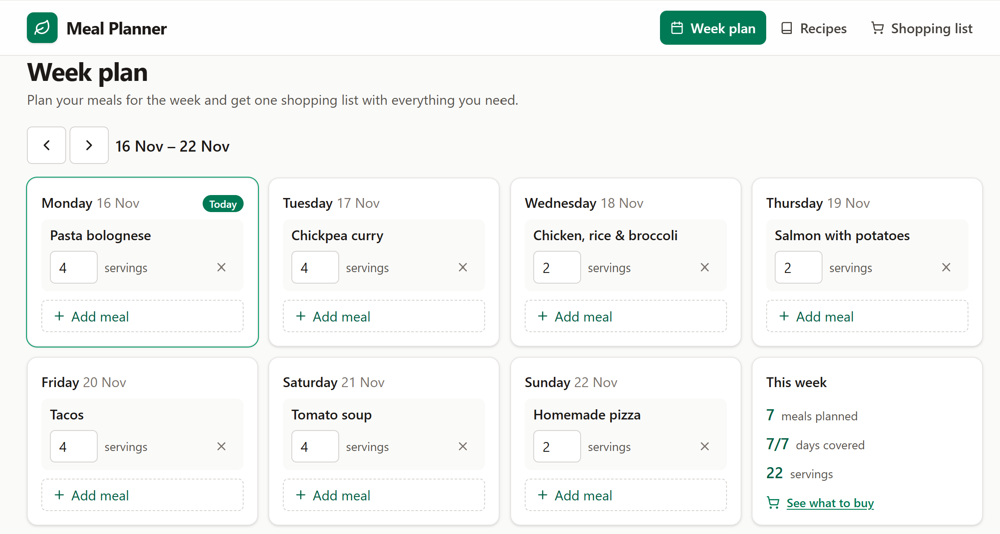

# 🥗 Meal Planner

[](https://github.com/hamzas4011/meal-planner/actions/workflows/ci.yml)

A full-stack web app to plan your meals for the week. It automatically works out what you need to buy.

Built with **React + TypeScript** on the frontend, an **ASP.NET Core (.NET 10) Web API** with **Entity Framework Core** on the backend, and **PostgreSQL** as the database. A **CI/CD** pipeline in **GitHub Actions** runs the tests on every push and deploys automatically to **Azure**.

**Add ingredients → build recipes → plan your week → get your shopping list.**

**🔗 Live demo: [Open the app](https://meal-planner-fre2hnc2b6eghndf.swedencentral-01.azurewebsites.net/)**


## Screenshots

### Week plan


### Recipes


### Shopping list


## Features

- **Example week:** one click fills the week with sample recipes, so you can try the app right away
- **Recipes:** create recipes with ingredients, quantities and servings
- **Week plan:** plan meals for each day, move between weeks, and undo a removed meal
- **Shopping list:** totals all ingredients for a date range, scaled to the planned servings. You can tick items off and print the list.
- **Accessible:** works with keyboard and screen readers, has visible labels, supports dark mode, and works on phones

## Tech stack

| | |
|---|---|
| **Frontend** | React 19, TypeScript, Vite, Tailwind CSS, React Router |
| **Backend** | ASP.NET Core (.NET 10) Web API, Entity Framework Core |
| **Database** | PostgreSQL (Neon in production) |
| **Testing** | xUnit with an EF Core in-memory database |
| **CI/CD** | GitHub Actions tests every push and deploys `main` to Azure App Service |
| **Container** | Docker: one image serves both the API and the frontend |

## Run locally

You need the [.NET 10 SDK](https://dotnet.microsoft.com/download), [Node.js 22+](https://nodejs.org/) and a PostgreSQL database.

```bash
# 1. Install dependencies
npm install
npm install --prefix meal-planner-web

# 2. Point the API at your database (stored outside the repo with user secrets)
dotnet user-secrets set "ConnectionStrings:DefaultConnection" \
  "Host=localhost;Database=mealplanner;Username=postgres;Password=yourpassword" \
  --project MealPlanner.Api

# 3. Create the database tables
dotnet tool install --global dotnet-ef   # only needed once
dotnet ef database update --project MealPlanner.Api

# 4. Start the API and the frontend together
npm run dev
```

Then open http://localhost:5173. Run the tests with `npm test`.

## Project structure

```
MealPlanner.Api/         ASP.NET Core API (controllers, models, DTOs, EF Core migrations)
MealPlanner.Api.Tests/   xUnit tests for the controllers
meal-planner-web/        React frontend
Dockerfile               Builds the frontend and API into one image
.github/workflows/       CI (build + test) and deployment to Azure
```
