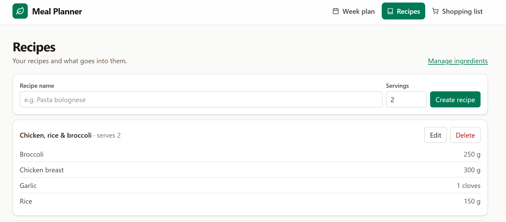
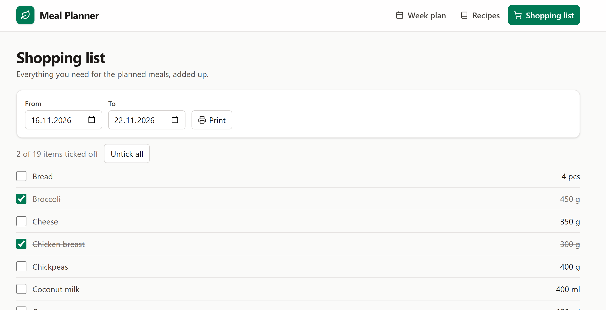

# 🥗 Meal Planner

[](https://github.com/hamzas4011/meal-planner/actions/workflows/ci.yml)

A full-stack web app to plan your meals for the week. It automatically works out what you need to buy.

**Add ingredients → build recipes → plan your week → get your shopping list.**

**🔗 Live demo: [Open the app](https://meal-planner-fre2hnc2b6eghndf.swedencentral-01.azurewebsites.net/)**

> No sign-up needed. Click **Try an example week** to fill the plan with sample recipes.
> The demo runs on a free hosting plan, so the first load can take up to a minute while the server wakes up.

## Screenshots

### Week plan


### Recipes


### Shopping list


## Features

- **Example week:** one click fills the week with sample recipes, so you can try the app right away
- **Recipes:** create recipes with ingredients, quantities and servings
- **Week plan:** plan meals for each day, move between weeks, and undo a removed meal
- **Shopping list:** totals all ingredients for a date range, scaled to the planned servings. You can tick items off and print the list.
- **Accessible:** works with keyboard and screen readers, has visible labels, supports dark mode, and works on phones

## Tech stack

| | |
|---|---|
| **Frontend** | React 19, TypeScript, Vite, Tailwind CSS, React Router |
| **Backend** | ASP.NET Core (.NET 10) Web API, Entity Framework Core |
| **Database** | PostgreSQL (Neon in production) |
| **Testing** | xUnit with an EF Core in-memory database |
| **CI/CD** | GitHub Actions tests every push and deploys `main` to Azure App Service |
| **Container** | Docker: one image serves both the API and the frontend |

## Run locally

Requires .NET 10, Node.js 22+ and PostgreSQL. Set the connection string with `dotnet user-secrets` in `MealPlanner.Api`, then:

```bash
npm install && npm install --prefix meal-planner-web
dotnet ef database update --project MealPlanner.Api
npm run dev
```

## Project structure

```
MealPlanner.Api/         ASP.NET Core API (controllers, models, DTOs, EF Core migrations)
MealPlanner.Api.Tests/   xUnit tests for the controllers
meal-planner-web/        React frontend
Dockerfile               Builds the frontend and API into one image
.github/workflows/       CI (build + test) and deployment to Azure
```
