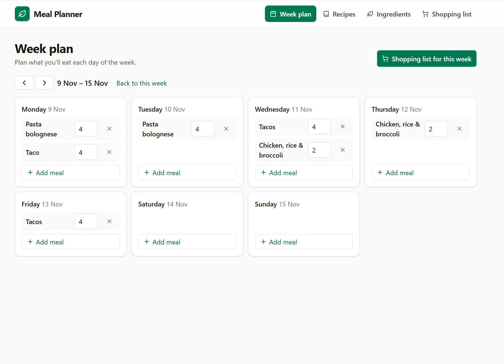

# 🥗 Meal Planner

[](https://github.com/hamzas4011/meal-planner/actions/workflows/ci.yml)

A full-stack web app to plan your meals for the week. It automatically works out what you need to buy.

**Add ingredients → build recipes → plan your week → get your shopping list.**

<!-- Add a screenshot here later, e.g.  -->

## Features

- **Recipes:** create recipes with ingredients, quantities and servings
- **Week plan:** plan meals for each day and move between weeks
- **Shopping list:** totals all ingredients for a date range, scaled to the planned servings. You can tick items off and print the list.
- **Accessible:** works with keyboard and screen readers, has visible labels, supports dark mode, and works on phones

## Tech stack

| | |
|---|---|
| **Frontend** | React 19, TypeScript, Vite, Tailwind CSS, React Router |
| **Backend** | ASP.NET Core (.NET 10) Web API, Entity Framework Core |
| **Database** | PostgreSQL |
| **Testing** | xUnit with an EF Core in-memory database |
| **CI** | GitHub Actions builds and tests every push |
| **Container** | Docker: one image serves both the API and the frontend |

## Project structure

```
MealPlanner.Api/         ASP.NET Core API (controllers, models, DTOs, EF Core migrations)
MealPlanner.Api.Tests/   xUnit tests for the controllers
meal-planner-web/        React frontend
Dockerfile               Builds the frontend and API into one image
.github/workflows/       CI pipeline
```